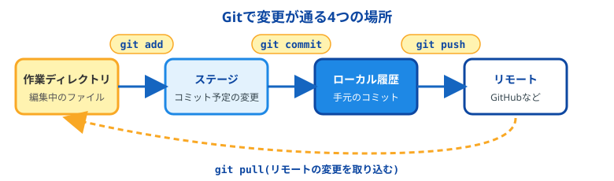
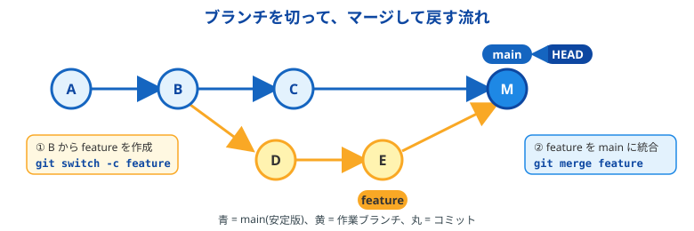
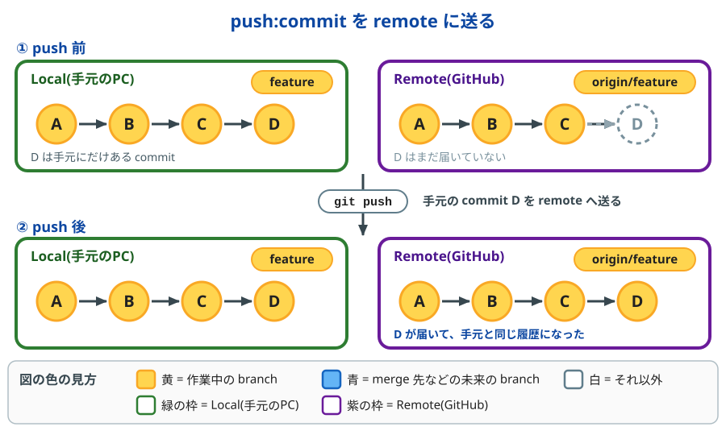
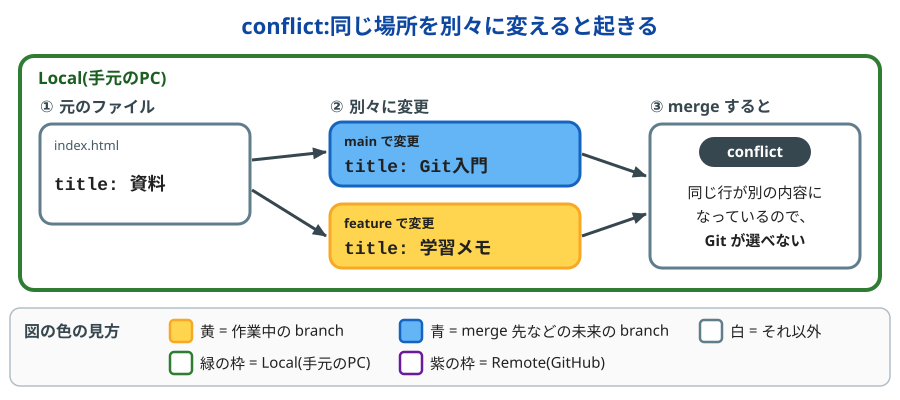
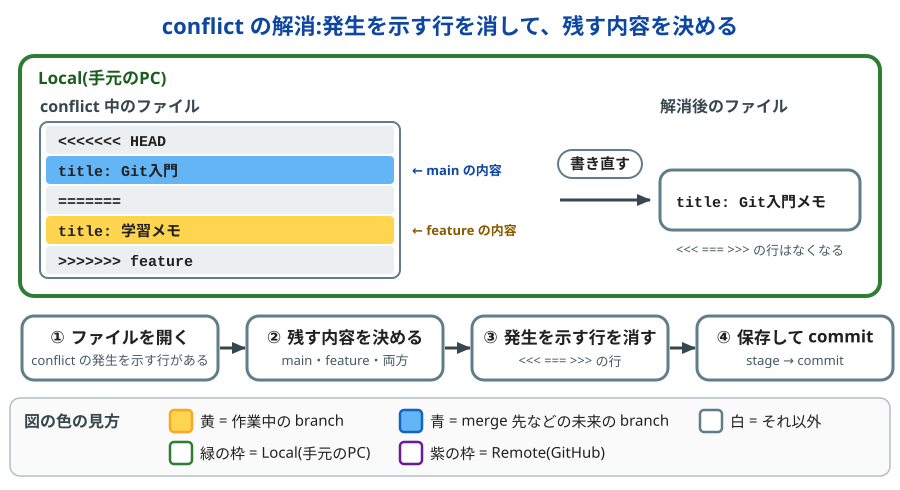
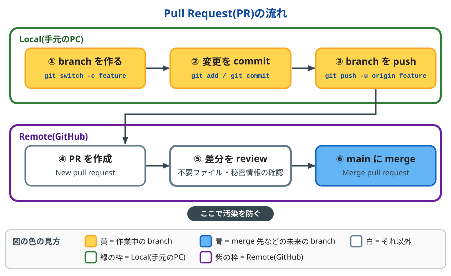
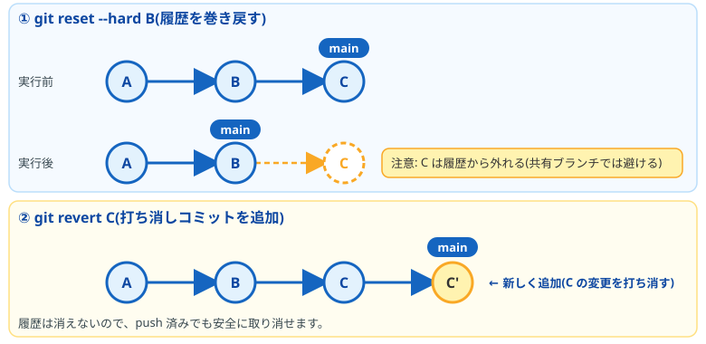
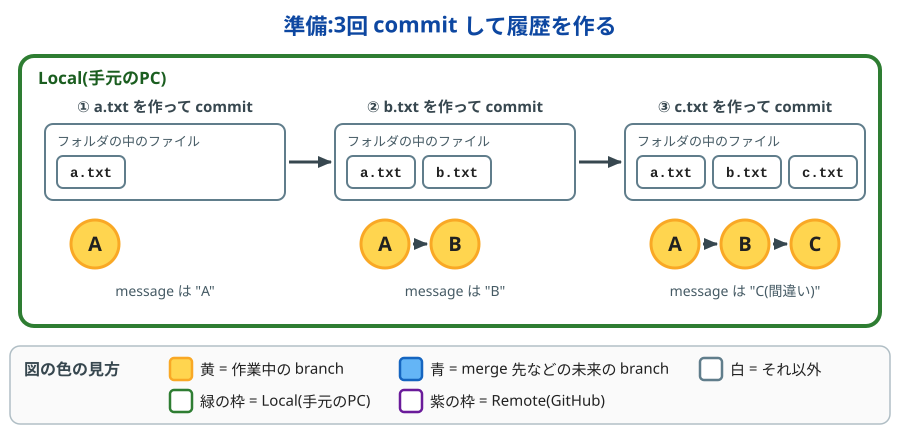
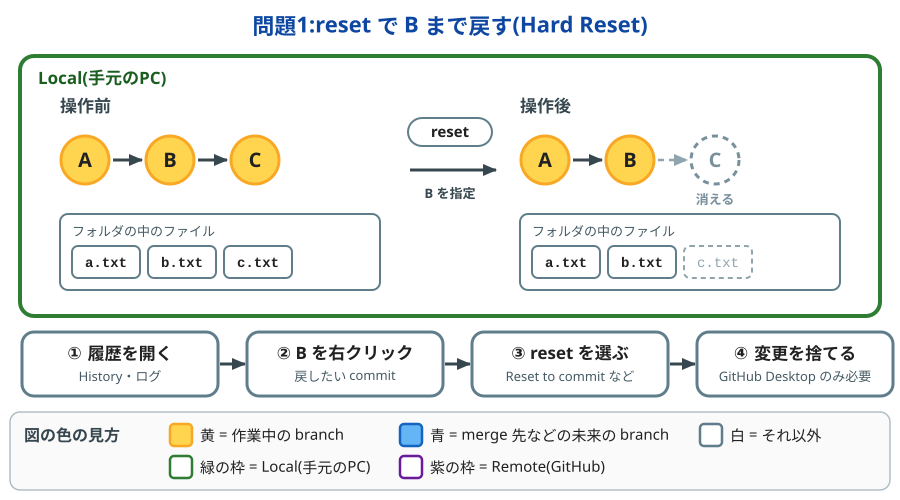
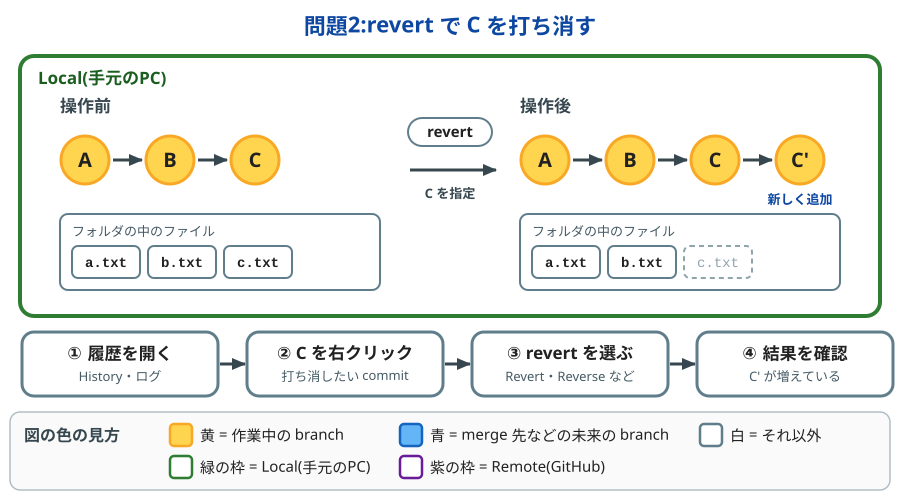

# Git入門:branch・commit と巻き戻し

## 目次

1. commit とは
2. branch とは
3. push とは
4. conflict とは
5. branch 汚染とは
6. 安全に試すコツ
7. 過去の commit に巻き戻す方法
8. GUIツール(GitHub Desktop・SourceTree・TortoiseGit)の用語集
9. 練習問題(reset と revert を GUI で試す)

---

## 1. commit とは

commit は、作業の途中経過を「セーブ」して、履歴に残すことです。ゲームのセーブのように、あとからその時点の状態に戻せます。commit を重ねると、変更の記録が順番に並んだ「履歴」になります。

各 commit には、見分けるための ID(hash)※ が自動で付きます。

※ hash とは、commit ごとに自動で付く、英数字の文字列です(例: `a1b2c3d`)。「背番号」のようなもので、巻き戻したいときに「この commit に戻す」と指定するのに使います。`git log --oneline` で確認できます。

変更は次の4つの場所を通ります。



- **working directory**: 実際にファイルを編集している場所(フォルダ)
- **stage**(図では Staging Area): 次の commit に含める変更を、いったん置いておく場所
- **local repository**: 手元の PC にある、commit の履歴
- **remote repository**: GitHub など、ネット上にある履歴

手元の PC 側を local、GitHub など外側を remote と呼びます。

```bash
git status                  # 今の状態を確認
git add ファイル名           # commit 対象にする(stage に載せる)
git commit -m "message"     # 手元の履歴に記録する
git push                    # remote へ送る
git log --oneline           # 履歴を一覧で見る
```

:::note info
`git pull` は、`git fetch`(remote の更新を取得するだけ)と `git merge`(手元に取り込む)をまとめた操作です。取り込む前に内容を確認したいときは、先に `git fetch` だけを実行します。
:::

---

## 2. branch とは

branch は、履歴の流れを枝分かれさせて、別々に作業を進めるための仕組みです。元の流れ(基本となる branch の `main`)に影響を与えずに、新機能の試作や修正を進められます。`HEAD` は「今自分がいる branch」を示す目印です。

使い方の基本は、`main` を安定版として保ち、作業は別の branch で行い、完成したら `main` に merge(変更を取り込んで合流)することです。



```bash
git branch                    # branch 一覧
git switch -c feature/timer   # branch を新しく作って、そこに移動
git switch main               # 移動
git merge feature/timer       # 今の branch に merge
git branch -d feature/timer   # merge 済みの branch を削除
```

:::note info
仕組みとしては、branch は commit に付けた名前(しおりのようなもの)です。ファイルを丸ごとコピーするわけではないので、作成は一瞬で軽く済みます。
:::

:::note info
古い解説では、branch の移動に `git checkout` が使われています。現在は `git switch`(branch の移動)と `git restore`(ファイルの復元)に役割が分かれていて、こちらのほうが分かりやすいため、この資料ではこの2つを使っています。
:::

---

## 3. push とは

push は、手元(local)の commit を remote(GitHub など)に送ることです。送られるのは commit 済みの内容だけで、commit していない変更は送られません。送る単位は branch です。



```bash
git remote -v                       # 送り先(origin)の URL を確認
git push -u origin feature/timer    # 初めて送る branch。送り先を origin に設定する
git push                            # 2回目以降。今の branch を、設定済みの送り先へ送る
git push origin main                # branch を指定して送る
```

`origin` は、remote につけられる標準の名前です。`-u` は「この branch の送り先を覚えておく」という指定で、1回付けて push すると、以降は `git push` だけで送れます。

:::note info
push のあとに `git status` を実行して、`up to date with 'origin/...'` と表示されれば、手元と remote が同じ状態です。
:::

:::note warn
remote のほうが先に進んでいる(他の人が先に push した)と、push は rejected(拒否)されます。その場合は、先に `git pull` で remote の変更を取り込んでから、もう一度 push します。`--force` で無理に上書きしないでください。
:::

---

## 4. conflict とは

conflict(コンフリクト)は、同じファイルの同じ場所を別々に変更したため、Git が「どちらを採用するか」を自動では決められない状態です。2人が同じ文章の同じ行を、別々に書き換えたときのようなものです。



- **起きるとき**: `git merge` で別の branch を取り込むときや、`git pull` で remote の変更を取り込むときに起きます
- **起きないとき**: 別のファイルや、同じファイルの別の場所を変更していた場合は、Git が自動で merge します

conflict はエラーではなく、「ここは人が決めてください」という Git からの確認です。

### conflict の解消方法

conflict が発生すると、Git は該当のファイルに、conflict の発生を示す行を書き込みます。この行を手がかりに、残す内容を決めます。

```text
<<<<<<< HEAD
title: Git入門
=======
title: 学習メモ
>>>>>>> feature
```

| conflict の発生を示す行 | 意味 |
|---|---|
| `<<<<<<< HEAD` 〜 `=======` | 今いる branch(`main`)の内容 |
| `=======` 〜 `>>>>>>> feature` | merge で取り込む branch(`feature`)の内容 |

解消は、conflict の発生を示す行を消して、残す内容を決めることです。



1. conflict が出たファイルを開く
2. 残す内容を決める(`main` の内容、`feature` の内容、または両方を合わせた内容)
3. conflict の発生を示す行(`<<<<<<<`、`=======`、`>>>>>>>` の3種類)を消す
4. 保存して、stage → commit で merge を完了する

```bash
git merge feature          # CONFLICT と表示される
git status                 # conflict のファイルを確認
# ファイルを開いて、conflict の発生を示す行を消して保存
git add index.html         # 解消したファイルを stage
git commit                 # merge を完了
```

GUIツールでは、次のように操作します。

| 手順 | GitHub Desktop | SourceTree | TortoiseGit |
|---|---|---|---|
| ① conflict のファイルを探す | Changes タブの conflicted files | ファイルを右クリック → Resolve Conflicts | conflict のファイルを右クリック → TortoiseGit のメニュー |
| ② 開いて直す | Open in エディタ名 | Launch External Merge Tool | Edit Conflicts |
| ③ 解消したと伝える | 自動で stage される | Mark Resolved | TortoiseGit → Resolved |
| ④ commit する | Commit merge | Commit | Git Commit |

:::note info
途中でやめたいときは、merge を取り消して元の状態に戻せます。GitHub Desktop は **Abort merge**、コマンドは `git merge --abort` です。
:::

:::note warn
SourceTree の `Resolve Using 'Mine'` / `Resolve Using 'Theirs'` は、ファイル全体をどちらか片方に置き換えます。conflict していない部分の変更も消えるので、画像などのバイナリファイルや、片方を丸ごと捨てるときだけ使ってください。
:::

:::note info
conflict を減らすには、作業を始める前に `git pull` で最新の状態にして、同じファイルを同時に別々の人が編集しないようにします。
:::

---

## 5. branch 汚染とは

branch 汚染は、本来入れたくないものが branch に混ざった状態です。よくある例は次のとおりです。

- `main` に直接、作りかけの変更を commit してしまった
- `.vs/` や `Library/` など、ツールが自動で作る不要なファイルを commit した
- パスワードやAPIキーなどの秘密情報を commit した
- 別の作業の commit が混ざったまま merge した

**予防策**

- 作業は必ず branch を切って行う
- `.gitignore`(commit しないファイルを指定する設定ファイル)を最初に用意する
- commit 前に `git status` と `git diff --staged` で中身を確認する
- **Pull Request(推奨)**: GitHub 上で「この branch を `main` に merge してください」と依頼する仕組みです。`main` へ直接 push せず、作業 branch を push して Pull Request(PR)を作り、差分を確認してから merge します。不要ファイルや秘密情報、別作業の commit の混入を、merge の前に見つけられます

```bash
git switch -c feature/timer          # 作業 branch を作る
git push -u origin feature/timer     # branch を push
# GitHub 上で Pull Request を作成 → 差分を確認 → merge
```

Pull Request の流れは次の図のとおりです。



:::note info
GitHub の設定(branch 保護)で `main` への直接 push を禁止すると、Pull Request を必ず通すようにできます。うっかり `main` に push してしまう事故を、仕組みで防げます。
:::

:::note info
`.gitignore` に書いたファイルは、まだ Git の管理に入っていない場合だけ無視されます。すでに commit してしまったファイルは、`git rm --cached ファイル名` で Git の管理から外してから(ファイル自体は消えません)、commit し直します。
:::

---

## 6. 安全に試すコツ

巻き戻しの前に、今の状態にバックアップ用の branch を作っておくと安心です。失敗しても、`git reset --hard backup-before-reset` で元の状態に戻せます。

```bash
git branch backup-before-reset
```

:::note info
バックアップ用の branch は、巻き戻しがうまくいったことを確認してから `git branch -d backup-before-reset` で削除します。
:::

---

## 7. 過去の commit に巻き戻す方法

**基本は、作業内容を過去の commit まで戻す(Hard Reset)か、打ち消す commit を作る(revert)のどちらかです。**
まだ push していなければ Hard Reset、push 済みなら revert が目安です。

状況によって使うコマンドが変わります。

### A. まだ commit していない変更を捨てる

```bash
git restore ファイル名           # ファイルの変更を破棄
git restore --staged ファイル名   # git add を取り消す(変更は残る)
git clean -fd                    # Git の管理に入っていない新しいファイルを削除
```

:::note warn
`git clean` で消えたファイルは戻せません。事前に `git clean -nd` で、削除される対象を確認してください。
:::

### B. commit 済みだが、まだ push していない

`git reset` で、今の branch を過去の commit の状態まで戻します。

```bash
git log --oneline               # 戻りたい commit の hash を調べる
git reset --soft HEAD~1         # 1つ前に戻る。変更は stage に残る
git reset --mixed HEAD~1        # 1つ前に戻る。変更は working directory に残る(既定)
git reset --hard a1b2c3d        # 指定した commit に戻る。以降の変更は消える
```

オプションによって、戻したあとに変更が残るかどうかが変わります。

| オプション | commit | stage | ファイルの中身 |
|---|---|---|---|
| `--soft` | 取り消す | 残る | 残る |
| `--mixed` | 取り消す | 取り消す | 残る |
| `--hard` | 取り消す | 取り消す | 消える |

:::note info
`HEAD~1` は「今の commit の1つ前」という意味です。`HEAD~2` なら2つ前を指します。
:::

:::note warn
`--hard` は、working directory の変更も消します。迷ったときは、先に `--soft` か `--mixed` を使うか、バックアップ用の branch を作ってから実行してください。
:::

### C. すでに push 済み(共同作業中)

履歴を書き換えずに、「打ち消す commit」を新しく作る `git revert` を使います。

```bash
git revert a1b2c3d              # その commit の変更を打ち消す commit を作る
git push
```

`reset` と `revert` の違いは次の図のとおりです。



:::note warn
push 済みの commit を reset で消し、`git push --force` で remote にも反映する方法もあります。ただし、他の人の履歴と食い違って混乱を招くので、共有 branch では避けるのが基本です。自分専用の branch でやむを得ない場合は、`--force` より安全な `git push --force-with-lease` を使います。
:::

### D. 間違えて `reset --hard` してしまった

`git reflog` は、HEAD が動いた記録をすべて残しています。消えたように見える commit も、多くの場合ここから戻せます。

```bash
git reflog                      # 操作履歴を見る
git reset --hard HEAD@{2}       # 戻りたい時点に復帰(`HEAD@{2}` は2回前の状態)
```

:::note warn
reflog の記録は一定期間(既定では約90日)で消えます。復元は早めに行ってください。
:::

### 迷ったときの選び方

| やりたいこと | 使うコマンド |
|---|---|
| commit 前の変更を捨てたい | `git restore` |
| まだ push していない commit をやり直したい | `git reset` |
| push 済みの変更を取り消したい | `git revert` |
| 消してしまった履歴を探したい | `git reflog` |

---

## 8. GUIツールの用語集

GUIツールのボタンやメニューは、どれも Git のコマンド(CUI)と同じことをしています。

| 意味 | Git(CUI) | GitHub Desktop | SourceTree | TortoiseGit |
|---|---|---|---|---|
| commit 対象に選ぶ | `git add` | 変更ファイルのチェック | Stage | Add |
| 変更を記録する | `git commit` | Commit | Commit | Git Commit |
| remote へ送る | `git push` | Push origin | Push | Git Push |
| 更新情報だけ取得する | `git fetch` | Fetch origin | Fetch | Git Fetch |
| 取得して取り込む | `git pull` | Pull origin | Pull | Git Pull |
| branch を作る | `git switch -c` | New Branch | Branch | Create Branch |
| branch を切り替える | `git switch` | Current Branch で選ぶ | Checkout | Switch/Checkout |
| branch を統合する | `git merge` | Merge into Current Branch | Merge | Merge |
| commit 前の変更を破棄する | `git restore` | Discard Changes | Discard | Revert |
| 過去に戻す | `git reset` | Reset to commit | Reset current branch to this commit | Reset to this |
| 打ち消しの commit を作る | `git revert` | Revert Changes in Commit | Reverse commit | Revert change by this commit |

:::note info
GitHub Desktop でも reset できます。**History** タブで戻したい commit を右クリックし、**Reset to commit** を選びます。

- 戻した後の変更は、working directory に未 commit の状態で残ります(`git reset --mixed` に近い動き)
- 変更もいらない場合は、そのあと **Discard Changes** で破棄します(`--hard` と同じ結果)
- 戻せるのは、最後に push した commit か、それより新しい commit までです(それより前には戻せません)
- push 済みの commit を取り消したいときは、reset ではなく **Revert Changes in Commit** を使います

参考: [Resetting to a commit in GitHub Desktop](https://docs.github.com/en/desktop/managing-commits/resetting-to-a-commit-in-github-desktop)
:::

:::note warn
メニュー名は、バージョンや表示言語で変わることがあります。
:::

---

## 9. 練習問題(reset と revert を GUI で試す)

GitHub Desktop・SourceTree・TortoiseGit のどれでも、同じ流れで試せます。手順は、図と同じ言葉(History、commit、reset、revert)で書いています。

:::note warn
練習用の新しい repository で試してください。本物のプロジェクトでは行わないでください。
:::

### 準備:練習用の履歴を作る



1. 練習用の新しい repository(履歴を保存する専用のフォルダ)を作る
2. その中に `a.txt` を作って commit する(message は `A`)
3. `b.txt` を作って commit する(message は `B`)
4. `c.txt` を作って commit する(message は `C(間違い)`)
5. History(ログ)に、A・B・C の3つが並んでいれば準備完了です

:::note info
message は、commit の説明文です。何でもかまいませんが、ここでは図と同じ A・B・C にします。
:::

| 操作 | GitHub Desktop | SourceTree | TortoiseGit |
|---|---|---|---|
| repository を作る | File → New repository | File → New → Create Local Repository | 空のフォルダを右クリック → Git Create repository here |
| commit する | 変更ファイルにチェック → message を入力 → Commit to main | ファイルを Stage → message を入力 → Commit | フォルダを右クリック → Git Commit → message を入力 → Commit |
| History を見る | History タブ | メイン画面の履歴(ログ) | フォルダを右クリック → Show Log |

### 問題1:reset で B まで戻す

C(間違い)の commit を、なかったことにします。目標は、a.txt と b.txt だけが残る状態(Hard Reset)です。



| 手順 | GitHub Desktop | SourceTree | TortoiseGit |
|---|---|---|---|
| ① 履歴を開く | History タブ | メイン画面の履歴 | Show Log |
| ② B を右クリック | History の commit B を右クリック | 履歴の commit B を右クリック | ログの commit B を右クリック |
| ③ reset を選ぶ | Reset to commit | Reset current branch to this commit → Hard を選ぶ | Reset to this → Hard を選ぶ |
| ④ 変更を捨てる | Changes タブで Discard All Changes | 不要(Hard で消える) | 不要(Hard で消える) |

**確認すること**:History から C が消え、フォルダから c.txt もなくなっています。

:::note info
GitHub Desktop の Reset to commit は、戻した後の変更を working directory に残す動きです。そのため、c.txt を消すには④で変更を捨てます。
:::

### 問題2:revert で C を打ち消す

履歴を消さずに、C の内容を打ち消す commit(C')を作ります。目標は、History に A・B・C・C' が残り、c.txt だけがフォルダから消える状態です。

問題1のあとは C が消えているので、新しい repository で準備をやり直してから始めます。



| 手順 | GitHub Desktop | SourceTree | TortoiseGit |
|---|---|---|---|
| ① 履歴を開く | History タブ | メイン画面の履歴 | Show Log |
| ② C を右クリック | History の commit C を右クリック | 履歴の commit C を右クリック | ログの commit C を右クリック |
| ③ revert を選ぶ | Revert Changes in Commit | Reverse commit | Revert change by this commit |
| ④ 結果を確認 | History に C' が増えている | History に C' が増えている | History に C' が増えている |

**確認すること**:History に C' が増え、C は残ったままです。フォルダから c.txt はなくなっています。

:::note info
ツールによっては、revert の途中で commit の確認画面が開きます。その場合は、そのまま commit まで進めてください。
:::

:::note warn
メニュー名は、バージョンや表示言語で変わることがあります。見つからないときは、commit を右クリックしたメニューを確認してください。
:::

### 2つの違い

| | reset | revert |
|---|---|---|
| 履歴 | C が消える | C は残り、C' が増える |
| 向いている場面 | まだ push していないとき | push 済みのとき |
