# 2.Git入門

## 目次

1. 用語集
2. commit とは
3. branch とは
4. push とは
5. merge とは
6. fetch と pull とは
7. 逆 merge とは(相手の branch を取り込む)
8. conflict とは
9. branch 汚染とは
10. 安全に試すコツ
11. 過去の commit に巻き戻す方法
12. GUIツール(GitHub Desktop・SourceTree・TortoiseGit)の用語集
13. 練習問題(reset と revert を GUI で試す)

このページでは、コマンドの打ち方ではなく、**用語の意味を覚えること**を目的にしています。GUI ツールのボタンや、画面に出てくるメッセージに「その名前が出てきたら、何を意味するのか」が分かるようになりましょう。

---

## 1. 用語集

この資料に出てくる Git の用語を、先にまとめて紹介します。くわしい説明は、2章以降で順番に行います。

| 用語 | 簡単な説明 |
|---|---|
| commit | 作業の途中経過を「セーブ」して、履歴に残すこと。また、その1回分の記録 |
| hash | commit ごとに自動で付く英数字の ID(背番号のようなもの) |
| branch | 履歴の流れを枝分かれさせて、別々に作業を進めるための仕組み |
| HEAD | 今自分がいる branch(や commit)を示す目印 |
| stage | 次の commit に含める変更を、いったん置いておく場所 |
| local / remote | local は手元の PC、remote は GitHub など、ネット上の置き場所 |
| push | 手元の commit を remote に送ること |
| fetch | remote の更新情報を取得するだけで、手元の作業には取り込まないこと |
| pull | remote の更新を取得して、今の branch に取り込むこと(fetch + merge) |
| merge | 別の branch の変更を、今の branch に取り込んで合流させること |
| 逆 merge | 最新の main を、自分が作業中の branch に取り込むこと(この資料での呼び方) |
| conflict | 同じ場所を別々に変更したため、Git が自動で merge できない状態 |
| Pull Request(PR) | 「この変更を取り込んでください」と GitHub 上で依頼し、確認してもらう仕組み |
| reset | 履歴を過去の commit まで巻き戻すこと |
| revert | 過去の commit を打ち消す、新しい commit を作ること |

---

## 2. commit とは

commit は、作業の途中経過を「セーブ」して、履歴に残すことです。ゲームのセーブのように、あとからその時点の状態に戻せます。commit を重ねると、変更の記録が順番に並んだ「履歴」になります。

各 commit には、見分けるための ID(hash)※ が自動で付きます。

※ hash とは、commit ごとに自動で付く、英数字の文字列です(例: `a1b2c3d`)。「背番号」のようなもので、巻き戻したいときに「この commit に戻す」と指定するのに使います。History(履歴の一覧)の画面で確認できます。

変更は次の4つの場所を通ります。

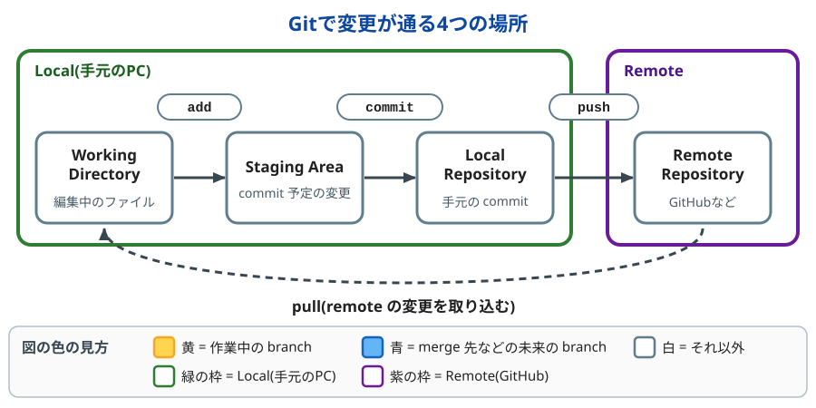

- **working directory**: 実際にファイルを編集している場所(フォルダ)
- **stage**(図では Staging Area): 次の commit に含める変更を、いったん置いておく場所
- **local repository**: 手元の PC にある、commit の履歴
- **remote repository**: GitHub など、ネット上にある履歴

手元の PC 側を local、GitHub など外側を remote と呼びます。

この流れで出てくる名前は、次の意味です。

- **status** という名前が出てきたら、今の状態(どのファイルが変更されているか、stage に載っているか)を確認するということです。
- **add**(Stage)という名前が出てきたら、変更を stage に載せる(commit の対象に選ぶ)ということです。
- **commit** という名前が出てきたら、stage にある変更を、手元の履歴に記録するということです。
- **message** という名前が出てきたら、その commit で何をしたかを書く説明文ということです。
- **push** という名前が出てきたら、手元の commit を remote へ送るということです。
- **log** や **History** という名前が出てきたら、commit の履歴の一覧ということです。

:::note info
- **fetch** という名前が出てきたら、remote の更新を取得する(まだ手元には取り込まない)ということです。
- **merge** という名前が出てきたら、取得した変更を手元に取り込むということです。
- **pull**(プル)という名前が出てきたら、fetch と merge をまとめて行うということです。

取り込む前に内容を確認したいときは、先に fetch だけを行います。
:::

---

## 3. branch とは

branch は、履歴の流れを枝分かれさせて、別々に作業を進めるための仕組みです。元の流れ(基本となる branch の `main`)に影響を与えずに、新機能の試作や修正を進められます。`HEAD` は「今自分がいる branch」を示す目印です。

使い方の基本は、`main` を安定版として保ち、作業は別の branch で行い、完成したら `main` に merge(変更を取り込んで合流)することです。

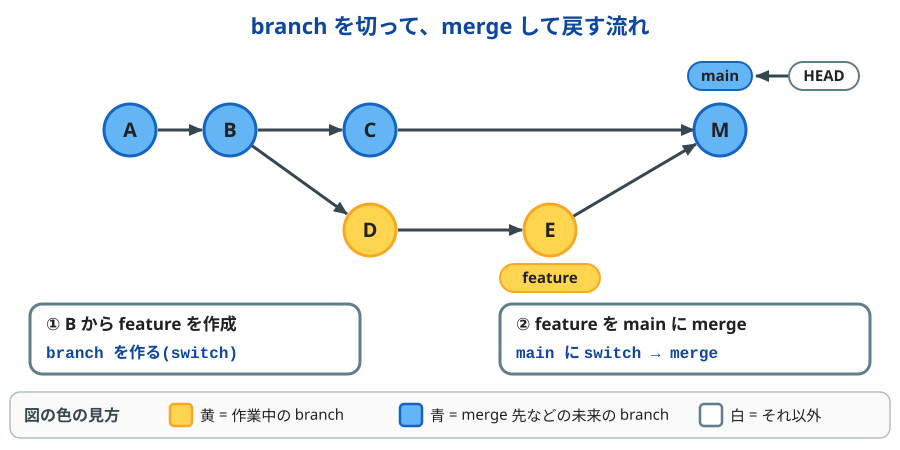

- **branch** という名前が出てきたら、枝分かれした作業の流れのことです。「branch を切る」は、新しい branch を作るということです。
- **main** という名前が出てきたら、基本となる、安定版の branch のことです。古い repository では **master** という名前のこともありますが、同じ役割です。
- **feature** という名前が出てきたら、新しい機能を作るための、作業用の branch ということです(例: `feature/timer`)。
- **switch** や **checkout** という名前が出てきたら、branch を切り替える(移動する)ということです。
- **merge** という名前が出てきたら、別の branch の変更を、今いる branch に取り込むということです。
- **delete branch** という名前が出てきたら、使い終わった branch を削除するということです。merge 済みなら、消しても変更は main に残っています。

:::note info
仕組みとしては、branch は commit に付けた名前(しおりのようなもの)です。ファイルを丸ごとコピーするわけではないので、作成は一瞬で軽く済みます。
:::

:::note info
**checkout** は、branch の移動に使われていた古い呼び方です。現在の Git では、branch の移動は **switch**、ファイルの復元は **restore** と、役割が分かれた名前になっています。SourceTree や TortoiseGit では、今も Checkout という名前が使われています。どちらが出てきても「branch を切り替える」と読みかえてください。
:::

---

## 4. push とは

push は、手元(local)の commit を remote(GitHub など)に送ることです。送られるのは commit 済みの内容だけで、commit していない変更は送られません。送る単位は branch です。

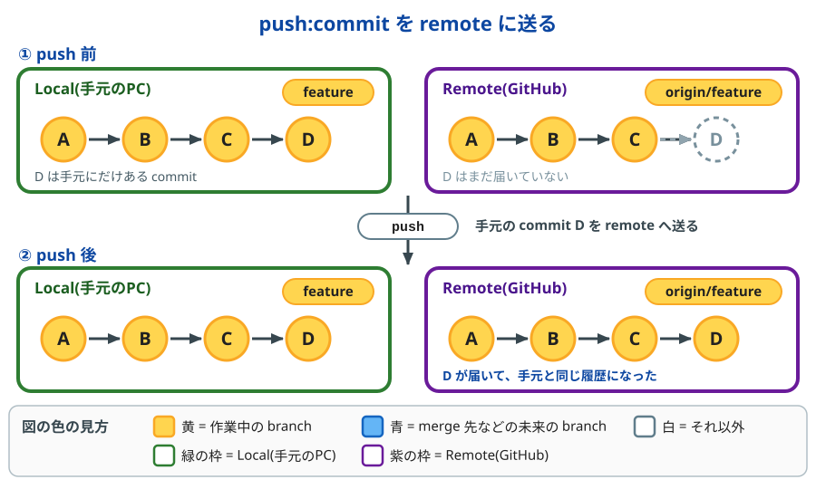

- **origin** という名前が出てきたら、remote(送り先)につけられた標準の名前のことです。ふつうは GitHub 上の repository を指します。
- **Publish branch** という名前が出てきたら、作った branch を、初めて remote に送るということです(GitHub Desktop の表示)。
- **upstream**(追跡先)という名前が出てきたら、「この branch はいつも、remote のこの branch に送る」という、覚えておいた送り先のことです。一度設定すると、2回目からは送り先を指定しなくても push できます。
- **Push origin** という名前が出てきたら、origin に push するということです。

:::note info
「**up to date with 'origin/...'**」という表示が出てきたら、手元と remote が同じ状態ということです。
:::

:::note warn
「**rejected**(拒否)」という表示が出てきたら、remote のほうが先に進んでいる(他の人が先に push した)ため、push できなかったということです。その場合は、先に pull で remote の変更を取り込んでから、もう一度 push します。**force push**(強制的に上書きする push)はしないでください。
:::

---

## 5. merge とは

merge は、別の branch で進めた作業を、今いる branch に取り込んで合流させることです。ふつうは、feature で作業が終わったら、`main` に取り込むために使います。

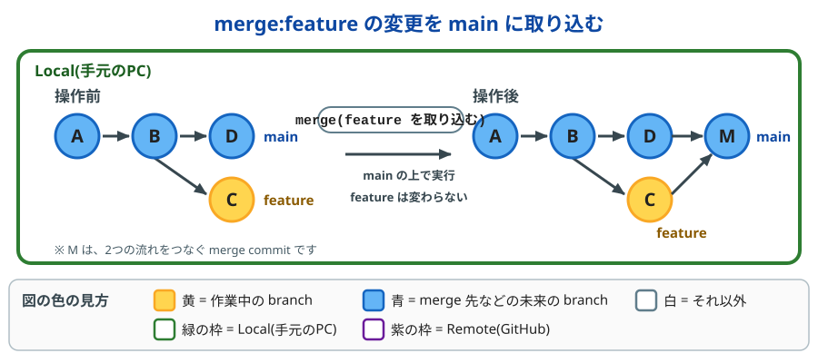

取り込む側ではなく、**取り込まれる側(merge 先)に移動してから**行うのがポイントです。

1. merge 先の branch(`main`)に切り替える
2. `feature` を、今の branch(`main`)に merge する

| 意味 | Git の用語 | GitHub Desktop | SourceTree | TortoiseGit |
|---|---|---|---|---|
| merge 先に切り替える | switch(checkout) | Current Branch で main を選ぶ | Checkout | Switch/Checkout |
| branch を取り込む | merge | Branch → Merge into Current Branch → feature を選ぶ | feature を右クリック → Merge | Merge → feature を選ぶ |

- **Merge into Current Branch** という名前が出てきたら、選んだ branch を、今いる branch に取り込むということです。
- **merge commit** という名前が出てきたら、2つの branch の変更をまとめた、合流のための commit ということです。
- **fast-forward** という名前が出てきたら、merge commit を作らずに、main を feature の位置まで進めるだけで済んだということです。

:::note info
merge すると、両方の変更をまとめた commit(merge commit)が1つ増えることがあります。main 側に新しい commit がなく、一直線につなげられるときは、merge commit は作られず、main が feature の位置まで進むだけです(fast-forward)。
:::

:::note warn
merge で変わるのは、今いる branch(merge 先)だけです。取り込んだ側の feature は変わりません。同じ場所を別々に変更していると conflict が起きます(「8. conflict とは」)。
:::

---

## 6. fetch と pull とは

他の人が remote に push すると、remote のほうが手元より先に進みます。その更新を手元に持ってくる方法が fetch と pull です。

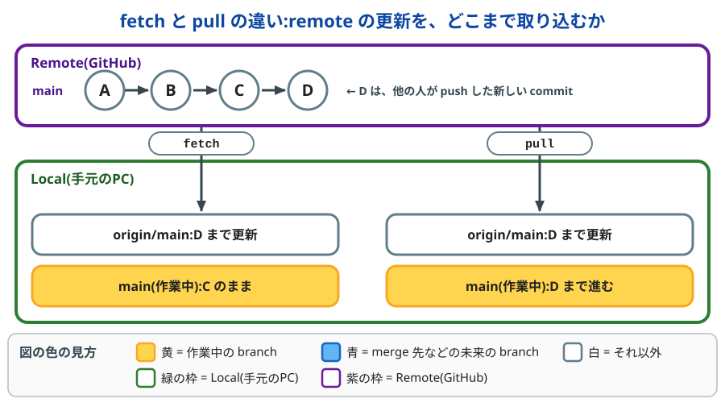

- **fetch** という名前が出てきたら、remote の更新情報を取得するだけということです。手元の `origin/main`(remote の main のコピー)は更新されますが、作業中の branch やファイルは変わりません。
- **pull** という名前が出てきたら、fetch に加えて、取得した内容を作業中の branch に merge するということです。つまり pull は「fetch + merge」です。
- **origin/main** という名前が出てきたら、「remote の main を、手元に控えておいたもの」ということです。自分の `main` とは別のものです。
- 「**behind 'origin/main' by 2 commits**」という表示が出てきたら、remote のほうが2つ先に進んでいて、手元に取り込んでいない commit があるということです。pull すると追いつきます。
- 「**ahead of 'origin/main' by 1 commit**」という表示が出てきたら、手元のほうが1つ先に進んでいて、まだ push していない commit があるということです。

| 意味 | Git の用語 | GitHub Desktop | SourceTree | TortoiseGit |
|---|---|---|---|---|
| 更新情報だけ取得する | fetch | Fetch origin | Fetch | Git Fetch |
| 取得して取り込む | pull | Pull origin | Pull | Git Pull |

:::note info
迷ったら、まず fetch で確認してから取り込むのが安全です。pull は、取り込み中に conflict が起きることがあります(「8. conflict とは」)。
:::

---

## 7. 逆 merge とは(相手の branch を取り込む)

ふつうの merge は、作業した feature を main に取り込みます。**逆 merge** はその反対で、最新の main(相手の branch)を、自分が作業中の branch に取り込むことです。正式な Git 用語ではなく、この資料での呼び方です。

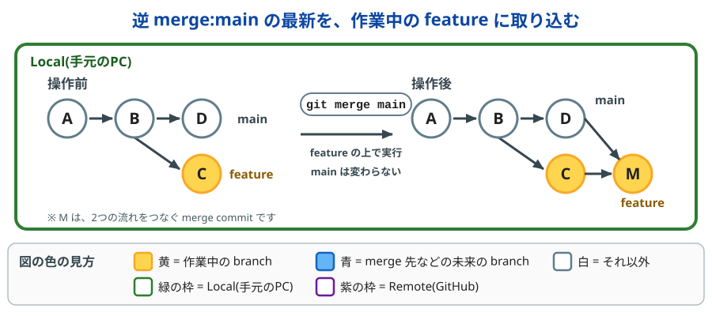

- **ふつうの merge**: 自分の branch → main(作業の完成を main に渡す)
- **逆 merge**: main → 自分の branch(main の最新を自分の branch に受け取る)

自分が作業している間に、ほかの人が main を更新していることがあります。そのまま作業を続けて Pull Request を出すと、最後に conflict が見つかって困ります。逆 merge で先に最新を取り込んでおけば、conflict を自分の branch の上で、早めに直せます。

1. `main` に切り替えて、pull で最新にする
2. 自分の branch(`feature`)に戻る
3. `main` を、今の branch(`feature`)に merge する(逆 merge)

| 意味 | Git の用語 | GitHub Desktop | SourceTree | TortoiseGit |
|---|---|---|---|---|
| 自分の branch に切り替える | switch(checkout) | Current Branch で選ぶ | Checkout | Switch/Checkout |
| main を取り込む | merge | Branch → Merge into Current Branch → main を選ぶ | main を右クリック → Merge | Merge → main を選ぶ |

- **update from main** や **Merge main into ...** という名前が出てきたら、main の最新を、自分の branch に取り込む(この資料でいう逆 merge)ということです。
- **rebase** という名前が出てきたら、逆 merge と同じく main の最新を取り込む別の方法ということです。merge commit を作らずに、自分の commit を main の先に付け替えます。初めのうちは、逆 merge(merge)を使えば十分です。

:::note info
取り込み先は、いま選んでいる(作業中の)branch です。merge する前に、必ず自分の branch に切り替わっていることを確認します。main に切り替えたまま実行すると、向きが逆になります。
:::

:::note warn
同じ場所を変更していると、逆 merge でも conflict が起きます。その場合は、「8. conflict とは」の手順で解消します。逆 merge の後は、自分の branch に merge commit が1つ増えます。
:::

---

## 8. conflict とは

conflict(コンフリクト)は、同じファイルの同じ場所を別々に変更したため、Git が「どちらを採用するか」を自動では決められない状態です。2人が同じ文章の同じ行を、別々に書き換えたときのようなものです。

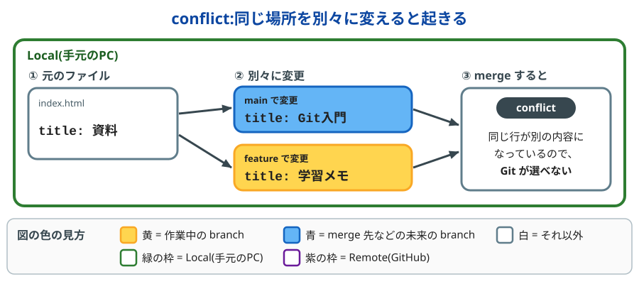

- **起きるとき**: merge で別の branch を取り込むときや、pull で remote の変更を取り込むときに起きます
- **起きないとき**: 別のファイルや、同じファイルの別の場所を変更していた場合は、Git が自動で merge します

conflict はエラーではなく、「ここは人が決めてください」という Git からの確認です。

- 「**CONFLICT**」という表示が出てきたら、自動で merge できない場所があったということです。
- 「**both modified**」や「**conflicted files**」という名前が出てきたら、そのファイルが両方の branch で変更されていて、conflict しているということです。

### conflict の解消方法

conflict が発生すると、Git は該当のファイルに、conflict の発生を示す行を書き込みます。この行を手がかりに、残す内容を決めます。

```text
<<<<<<< HEAD
title: Git入門
=======
title: 学習メモ
>>>>>>> feature
```

| conflict の発生を示す行 | 意味 |
|---|---|
| `<<<<<<< HEAD` 〜 `=======` | 今いる branch(この例では `main`)の内容 |
| `=======` 〜 `>>>>>>> feature` | merge で取り込む branch(`feature`)の内容 |

解消は、conflict の発生を示す行を消して、残す内容を決めることです。

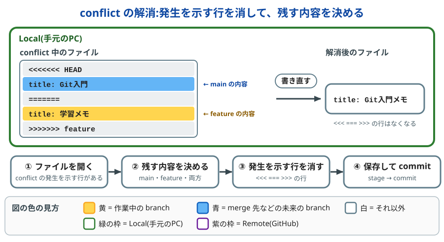

1. conflict が出たファイルを開く
2. 残す内容を決める(`main` の内容、`feature` の内容、または両方を合わせた内容)
3. conflict の発生を示す行(`<<<<<<<`、`=======`、`>>>>>>>` の3種類)を消す
4. 保存して、stage に載せる(解消したと伝える)
5. commit して、merge を完了する

GUIツールでは、次のように操作します。

| 手順 | GitHub Desktop | SourceTree | TortoiseGit |
|---|---|---|---|
| ① conflict のファイルを探す | Changes タブの conflicted files | ファイルを右クリック → Resolve Conflicts | conflict のファイルを右クリック → TortoiseGit のメニュー |
| ② 開いて直す | Open in エディタ名 | Launch External Merge Tool | Edit Conflicts |
| ③ 解消したと伝える | 自動で stage される | Mark Resolved | TortoiseGit → Resolved |
| ④ commit する | Commit merge | Commit | Git Commit |

- **Resolve** / **Resolved** / **Mark Resolved** という名前が出てきたら、conflict を解消した(解消したと Git に伝える)ということです。
- **Mine**(ours)という名前が出てきたら、今いる branch 側の内容ということです。
- **Theirs** という名前が出てきたら、merge で取り込もうとしている相手の branch 側の内容ということです。

:::note info
**Abort merge**(merge の中止)という名前が出てきたら、merge を取り消して、merge する前の状態に戻すということです。途中でやめたいときに使います。
:::

:::note warn
SourceTree の `Resolve Using 'Mine'` / `Resolve Using 'Theirs'` は、ファイル全体をどちらか片方に置き換えます。conflict していない部分の変更も消えるので、画像などのバイナリファイルや、片方を丸ごと捨てるときだけ使ってください。
:::

:::note info
conflict を減らすには、作業を始める前に pull で最新の状態にして、同じファイルを同時に別々の人が編集しないようにします。
:::

---

## 9. branch 汚染とは

branch 汚染は、本来入れたくないものが branch に混ざった状態です。よくある例は次のとおりです。

- `main` に直接、作りかけの変更を commit してしまった
- `.vs/` や `Library/` など、ツールが自動で作る不要なファイルを commit した
- パスワードやAPIキーなどの秘密情報を commit した
- 別の作業の commit が混ざったまま merge した

**予防策**

- 作業は必ず branch を切って行う
- `.gitignore` を最初に用意する
- commit 前に、status と diff で中身を確認する
- **Pull Request(推奨)**: `main` へ直接 push せず、作業 branch を push して Pull Request(PR)を作り、差分を確認してから merge します。不要ファイルや秘密情報、別作業の commit の混入を、merge の前に見つけられます

Pull Request の流れは次の図のとおりです。

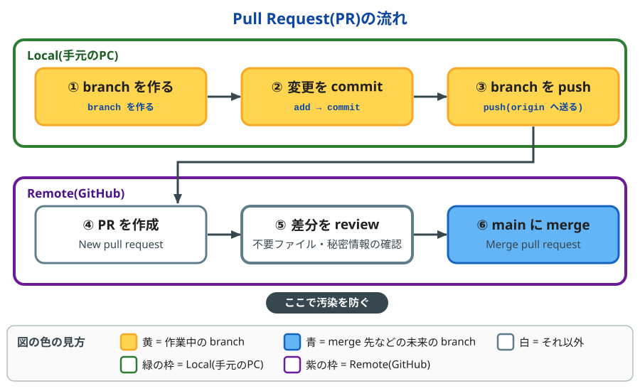

- **.gitignore** という名前が出てきたら、「このファイルは commit しない」と指定する設定ファイルのことです。
- **diff**(差分)という名前が出てきたら、変更前と変更後で、どこが変わったかを表示したものということです。
- **Pull Request** という名前が出てきたら、GitHub 上で「この branch を `main` に merge してください」と依頼する仕組みのことです。
- **branch protection**(branch 保護)という名前が出てきたら、`main` などへの直接 push を禁止して、Pull Request を必ず通すようにする GitHub の設定のことです。

:::note info
branch 保護を設定すると、うっかり `main` に push してしまう事故を、仕組みで防げます。
:::

:::note info
`.gitignore` に書いたファイルは、まだ Git の管理に入っていない場合だけ無視されます。すでに commit してしまったファイルは、Git の管理から外して(**untrack**。ファイル自体は消えません)、commit し直します。**untrack** という名前が出てきたら、ファイルは残したまま、Git の記録の対象から外すということです。
:::

---

## 10. 安全に試すコツ

巻き戻しの前に、今の状態にバックアップ用の branch(例: `backup-before-reset`)を作っておくと安心です。巻き戻しに失敗しても、その branch の状態まで reset すれば、元に戻せます。

- **backup**(バックアップ用の branch)という名前が出てきたら、作業前の状態を残しておくための、一時的な branch ということです。

:::note info
バックアップ用の branch は、巻き戻しがうまくいったことを確認してから削除します。
:::

---

## 11. 過去の commit に巻き戻す方法

**基本は、作業内容を過去の commit まで戻す(Hard Reset)か、打ち消す commit を作る(revert)のどちらかです。**
まだ push していなければ Hard Reset、push 済みなら revert が目安です。

状況によって、使う操作の名前が変わります。

### A. まだ commit していない変更を捨てる

- **Discard**(Discard Changes)や **restore** という名前が出てきたら、commit していないファイルの変更を捨てて、最後の commit の状態に戻すということです。
- **unstage** という名前が出てきたら、stage から外す(add を取り消す)ということです。ファイルの変更は残ります。
- **clean** という名前が出てきたら、Git の管理に入っていない(untracked の)新しいファイルを削除するということです。

:::note warn
Discard や clean で消えた変更は戻せません。実行する前に、消える対象を確認してください。
:::

### B. commit 済みだが、まだ push していない

reset で、今の branch を過去の commit の状態まで戻します。reset には3つの種類があり、戻したあとに変更が残るかどうかが変わります。

| 種類 | commit | stage | ファイルの中身 |
|---|---|---|---|
| Soft | 取り消す | 残る | 残る |
| Mixed(既定) | 取り消す | 取り消す | 残る |
| Hard | 取り消す | 取り消す | 消える |

- **reset** という名前が出てきたら、今の branch を、指定した過去の commit の状態まで戻すということです。
- **Soft** という名前が出てきたら、commit だけを取り消して、変更は stage に残すということです。
- **Mixed** という名前が出てきたら、commit と stage を取り消して、変更は working directory に残すということです。
- **Hard** という名前が出てきたら、commit も変更もすべて消して、指定した commit の状態にするということです。

:::note info
**HEAD~1**(または **HEAD^**)という名前が出てきたら、「今の commit の1つ前」ということです。**HEAD~2** なら2つ前を指します。
:::

:::note warn
Hard は、working directory の変更も消します。迷ったときは、先に Soft か Mixed を使うか、バックアップ用の branch を作ってから実行してください。
:::

### C. すでに push 済み(共同作業中)

履歴を書き換えずに、「打ち消す commit」を新しく作る revert を使います。打ち消す commit を作ったら、push します。

- **revert** という名前が出てきたら、指定した commit の変更を打ち消す、新しい commit を作るということです。元の commit は履歴に残ります。

reset と revert の違いは次の図のとおりです。

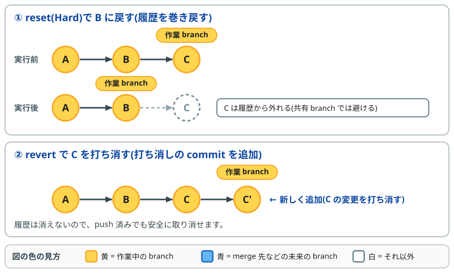

:::note warn
- **force push** という名前が出てきたら、remote の履歴を、手元の履歴で強制的に上書きするということです。push 済みの commit を reset で消し、force push で remote にも反映する方法もありますが、他の人の履歴と食い違って混乱を招くので、共有 branch では避けるのが基本です。
- **force with lease** という名前が出てきたら、「自分が知らない変更が remote に増えていたら、上書きしない」という安全装置つきの force push ということです。自分専用の branch でやむを得ない場合は、こちらを使います。
:::

### D. 間違えて Hard Reset してしまった

- **reflog** という名前が出てきたら、HEAD が動いた記録(操作の履歴)のことです。消えたように見える commit も、多くの場合ここから見つけて、その時点に戻せます。
- **HEAD@{2}** という名前が出てきたら、reflog の中で「2回前に HEAD があった場所」ということです。

:::note warn
reflog の記録は一定期間(既定では約90日)で消えます。復元は早めに行ってください。
:::

### 迷ったときの選び方

| やりたいこと | 覚える名前 |
|---|---|
| commit 前の変更を捨てたい | Discard / restore |
| まだ push していない commit をやり直したい | reset |
| push 済みの変更を取り消したい | revert |
| 消してしまった履歴を探したい | reflog |

---

## 12. GUIツールの用語集

GUIツールのボタンやメニューは、名前が違っても、Git の同じ操作をしています。左の「Git の用語」を覚えておけば、どのツールでも何をするボタンか分かります。

| 意味 | Git の用語 | GitHub Desktop | SourceTree | TortoiseGit |
|---|---|---|---|---|
| commit 対象に選ぶ | add | 変更ファイルのチェック | Stage | Add |
| 変更を記録する | commit | Commit | Commit | Git Commit |
| remote へ送る | push | Push origin | Push | Git Push |
| 更新情報だけ取得する | fetch | Fetch origin | Fetch | Git Fetch |
| 取得して取り込む | pull | Pull origin | Pull | Git Pull |
| branch を作る | branch | New Branch | Branch | Create Branch |
| branch を切り替える | switch(checkout) | Current Branch で選ぶ | Checkout | Switch/Checkout |
| branch を統合する | merge | Merge into Current Branch | Merge | Merge |
| commit 前の変更を破棄する | restore(discard) | Discard Changes | Discard | Revert |
| 過去に戻す | reset | Reset to commit | Reset current branch to this commit | Reset to this |
| 打ち消しの commit を作る | revert | Revert Changes in Commit | Reverse commit | Revert change by this commit |

:::note warn
TortoiseGit の **Revert** は、「commit 前の変更を破棄する」(restore / discard)という意味で、Git の用語の revert(打ち消しの commit を作る)とは別の操作です。TortoiseGit で打ち消しの commit を作るのは **Revert change by this commit** です。
:::

:::note info
GitHub Desktop でも reset できます。**History** タブで戻したい commit を右クリックし、**Reset to commit** を選びます。

- 戻した後の変更は、working directory に未 commit の状態で残ります(Mixed に近い動き)
- 変更もいらない場合は、そのあと **Discard Changes** で破棄します(Hard と同じ結果)
- 戻せるのは、最後に push した commit か、それより新しい commit までです(それより前には戻せません)
- push 済みの commit を取り消したいときは、reset ではなく **Revert Changes in Commit** を使います

参考: [Resetting to a commit in GitHub Desktop](https://docs.github.com/en/desktop/managing-commits/resetting-to-a-commit-in-github-desktop)
:::

:::note warn
メニュー名は、バージョンや表示言語で変わることがあります。
:::

---

## 13. 練習問題(reset と revert を GUI で試す)

GitHub Desktop・SourceTree・TortoiseGit のどれでも、同じ流れで試せます。手順は、図と同じ言葉(History、commit、reset、revert)で書いています。

:::note warn
練習用の新しい repository で試してください。本物のプロジェクトでは行わないでください。
:::

### 準備:練習用の履歴を作る

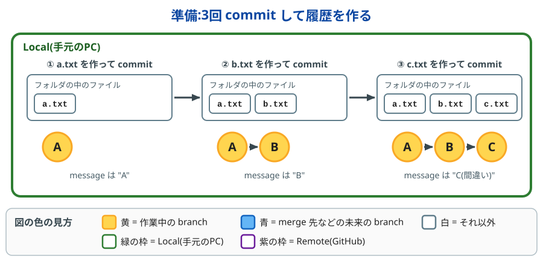

1. 練習用の新しい repository(履歴を保存する専用のフォルダ)を作る
2. その中に `a.txt` を作って commit する(message は `A`)
3. `b.txt` を作って commit する(message は `B`)
4. `c.txt` を作って commit する(message は `C(間違い)`)
5. History(ログ)に、A・B・C の3つが並んでいれば準備完了です

:::note info
message は、commit の説明文です。何でもかまいませんが、ここでは図と同じ A・B・C にします。
:::

| 操作 | GitHub Desktop | SourceTree | TortoiseGit |
|---|---|---|---|
| repository を作る | File → New repository | File → New → Create Local Repository | 空のフォルダを右クリック → Git Create repository here |
| commit する | 変更ファイルにチェック → message を入力 → Commit to main | ファイルを Stage → message を入力 → Commit | フォルダを右クリック → Git Commit → message を入力 → Commit |
| History を見る | History タブ | メイン画面の履歴(ログ) | フォルダを右クリック → Show Log |

### 問題1:reset で B まで戻す

C(間違い)の commit を、なかったことにします。目標は、a.txt と b.txt だけが残る状態(Hard Reset)です。

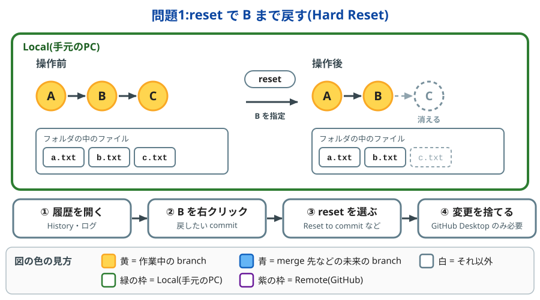

| 手順 | GitHub Desktop | SourceTree | TortoiseGit |
|---|---|---|---|
| ① 履歴を開く | History タブ | メイン画面の履歴 | Show Log |
| ② B を右クリック | History の commit B を右クリック | 履歴の commit B を右クリック | ログの commit B を右クリック |
| ③ reset を選ぶ | Reset to commit | Reset current branch to this commit → Hard を選ぶ | Reset to this → Hard を選ぶ |
| ④ 変更を捨てる | Changes タブで Discard All Changes | 不要(Hard で消える) | 不要(Hard で消える) |

**確認すること**:History から C が消え、フォルダから c.txt もなくなっています。

:::note info
GitHub Desktop の Reset to commit は、戻した後の変更を working directory に残す動きです。そのため、c.txt を消すには④で変更を捨てます。
:::

### 問題2:revert で C を打ち消す

履歴を消さずに、C の内容を打ち消す commit(C')を作ります。目標は、History に A・B・C・C' が残り、c.txt だけがフォルダから消える状態です。

問題1のあとは C が消えているので、新しい repository で準備をやり直してから始めます。

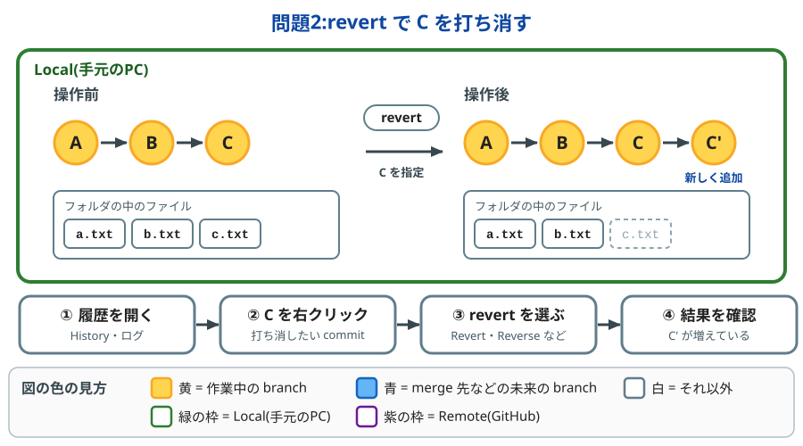

| 手順 | GitHub Desktop | SourceTree | TortoiseGit |
|---|---|---|---|
| ① 履歴を開く | History タブ | メイン画面の履歴 | Show Log |
| ② C を右クリック | History の commit C を右クリック | 履歴の commit C を右クリック | ログの commit C を右クリック |
| ③ revert を選ぶ | Revert Changes in Commit | Reverse commit | Revert change by this commit |
| ④ 結果を確認 | History に C' が増えている | History に C' が増えている | History に C' が増えている |

**確認すること**:History に C' が増え、C は残ったままです。フォルダから c.txt はなくなっています。

:::note info
ツールによっては、revert の途中で commit の確認画面が開きます。その場合は、そのまま commit まで進めてください。
:::

:::note warn
メニュー名は、バージョンや表示言語で変わることがあります。見つからないときは、commit を右クリックしたメニューを確認してください。
:::

### 2つの違い

| | reset | revert |
|---|---|---|
| 履歴 | C が消える | C は残り、C' が増える |
| 向いている場面 | まだ push していないとき | push 済みのとき |
