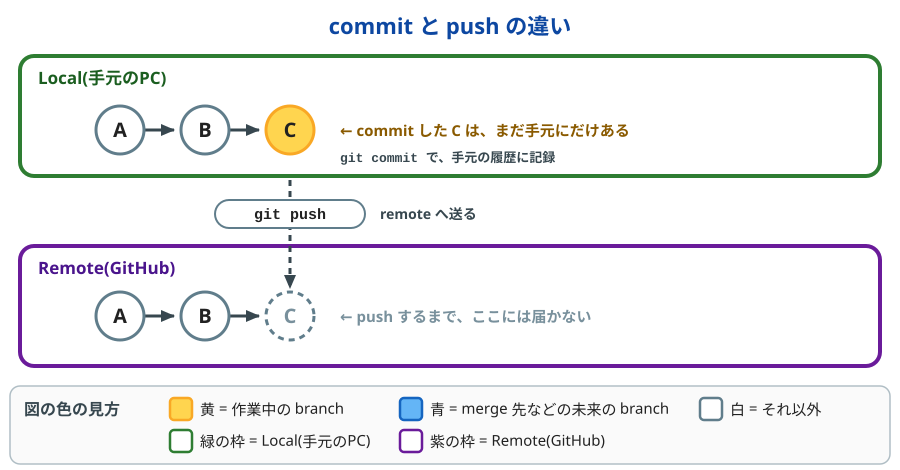
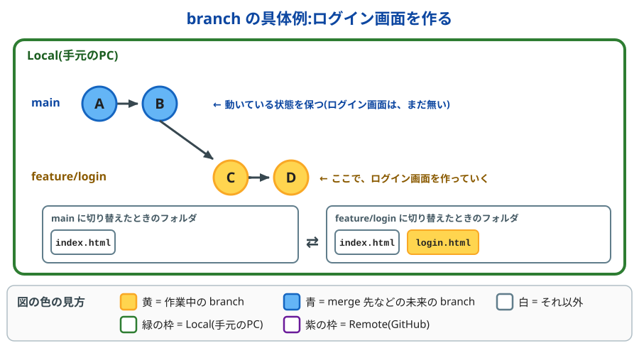
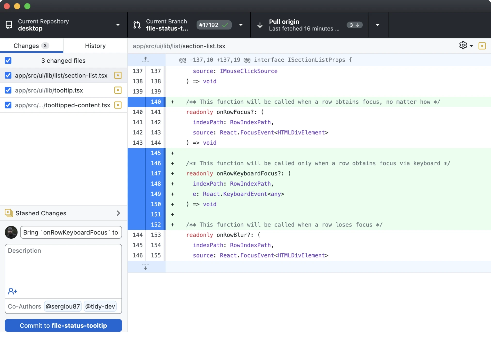
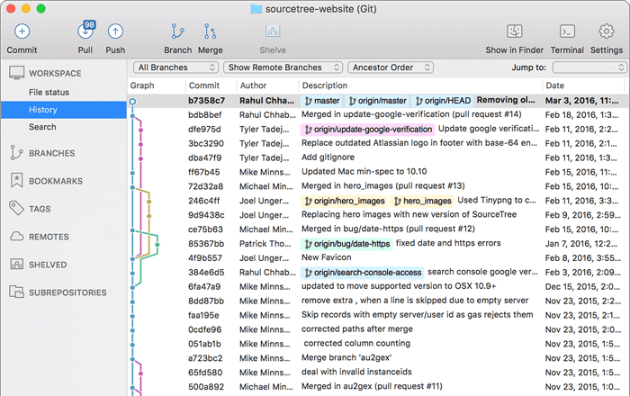
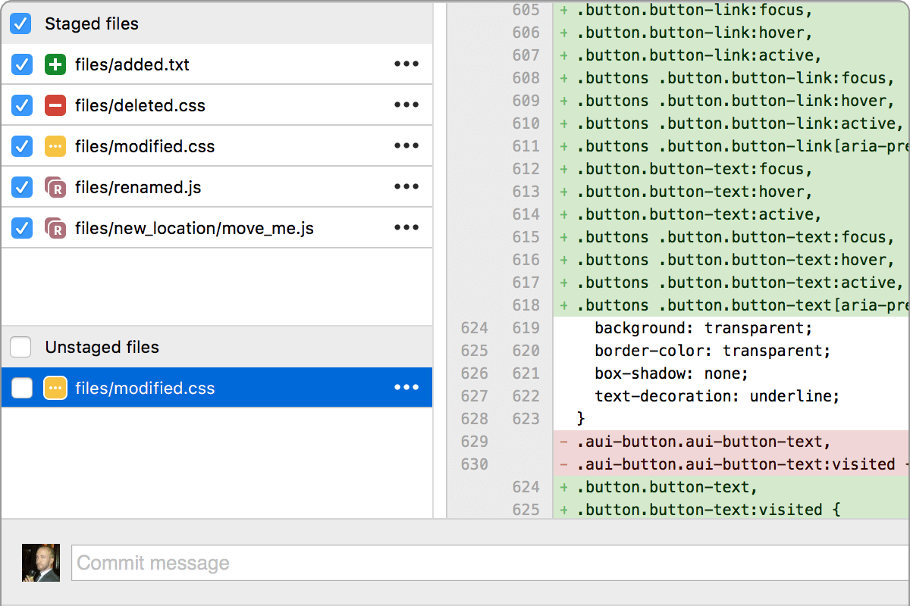
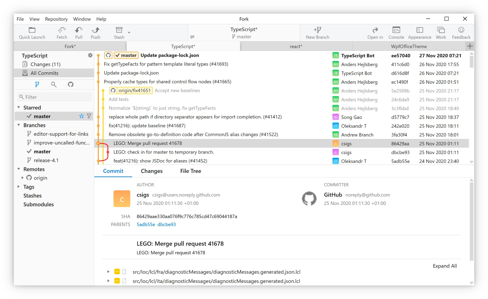
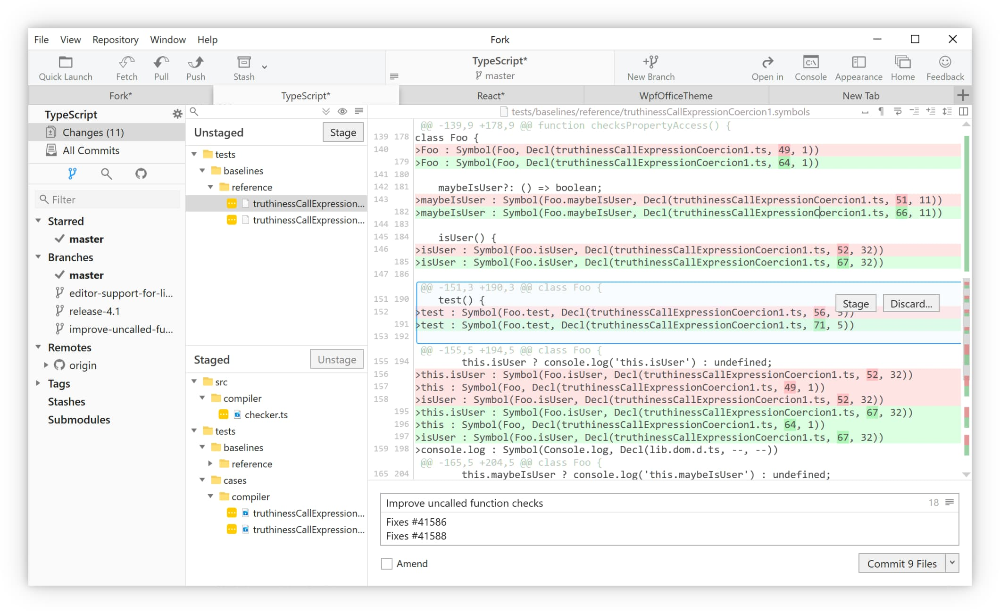

# 1.Gitの概念

## 目次

1. Git と GitHub の違い
2. commit と push の違い
3. stage の役割
4. branch の仕組み(具体例つき)
5. 開発開始から終了までの流れ
6. Git を扱うクライアント(GitHub Desktop・Sourcetree・Fork)

「なぜ必要なの?」「何が違うの?」という疑問に答える、Git の基本の考え方を説明するページです。このページでは、コマンドの打ち方ではなく、**用語の意味を覚えること**を目的にしています。画面やメッセージに出てくる名前が、何を意味しているのかが分かるようになりましょう。用語集や、GUI ツールのボタンの名前は、[2.Git入門](../git/index.html) にまとめています。

---

## 1. Git と GitHub の違い

名前は似ていますが、別のものです。

| | Git | GitHub |
|---|---|---|
| 何か | 履歴を記録・管理する**道具**(ソフトウェア) | Git の履歴を置いて共有する**サービス**(Web サイト) |
| どこにあるか | 自分の PC の中 | ネット上(remote) |
| ネットは必要か | 不要(commit や branch は PC の中だけで使える) | 必要 |
| できること | commit、branch、履歴の確認、巻き戻し | 履歴の共有、Pull Request、review、issue の管理 |

たとえると、Git は「ゲームのセーブ機能」、GitHub は「セーブデータを預けておく共有の棚」です。セーブ機能だけでも使えますが、棚に預けることで、ほかの人と同じデータを見たり、バックアップにしたりできます。

:::note info
GitHub のように、Git の履歴を置けるサービスは、ほかにもあります(GitLab、Bitbucket など)。Git の使い方は共通で、「どこに置くか」だけが違います。
:::

:::note info
Git を使うだけなら、GitHub のアカウントは要りません。共同作業をするとき、または履歴をネット上に置きたいときに、GitHub を使います。
:::

### GitHub は無料? 作ったものは公開される?

GitHub は、個人で使う分には**無料**で使えます。有料プランもありますが、会社やチームで細かい管理機能が必要になったときのためのもので、学習や個人の開発なら無料プランで足ります。

作ったものが全世界に公開されるかどうかは、repository(履歴を保存する置き場所)ごとに、**public** と **private** のどちらかを選んで決めます。

| | public(公開) | private(非公開) |
|---|---|---|
| 見られる人 | ネット上の誰でも | 自分と、自分が招待した人だけ |
| 変更できる人 | 自分と、自分が許可した人だけ | 自分と、自分が許可した人だけ |
| 向いているもの | 公開して見てもらいたいもの(学習の成果、公開資料など) | 仕事のもの、まだ人に見せたくないもの |
| 無料プランで使えるか | 使える | 使える |

- **public** という名前が出てきたら、誰でも中身を見られる(ただし、勝手に書き換えられることはない)ということです。
- **private** という名前が出てきたら、自分と招待した人だけが見られるということです。

public と private は、作ったあとでも repository の設定(Settings)から切り替えられます。

:::note warn
public にすると、今のファイルだけでなく、**過去の commit の履歴もすべて**見られるようになります。途中でパスワードなどを commit して、あとで消したつもりでも、履歴には残っています。public にする前に、秘密情報が入っていないか確認してください。
:::

:::note info
GitHub Pages(repository の中身を Web ページとして公開する機能)は、無料プランでは public の repository でだけ使えます。
:::

### Git は何を記録しているの?(履歴の中身)

commit すると、Git は次のものを、ひとまとめにして記録します。この1回分のまとまりが「commit」で、commit が順番につながったものが「履歴」です。

| 記録されるもの | 内容 |
|---|---|
| ファイルの中身 | その時点の、フォルダ全体の状態(スナップショット※) |
| message | 「ログイン画面を追加」など、何をしたかの説明 |
| 作成者と日時 | 誰が、いつ commit したか |
| 1つ前の commit | どの commit の続きか(これで履歴がつながる) |
| hash | commit を見分けるための ID(英数字の文字列) |

※ スナップショットとは、その瞬間のフォルダ全体を写真に撮ったようなものです。

「フォルダ全体を毎回記録するなら、すぐに容量がいっぱいになるのでは?」と思うかもしれません。実際には、**変更していないファイルは、前の commit と同じものを指すだけで、もう一度コピーはしません**。変更したファイルだけが新しく保存されるので、commit を何度くり返しても、それほど重くなりません。

たとえると、アルバムに毎回フォルダ全体の写真を貼っているように見えて、変わっていない部分は「前のページと同じ」と書いてあるだけ、というイメージです。

- **snapshot(スナップショット)** という名前が出てきたら、その時点のフォルダ全体の状態ということです。
- **diff(差分)** という名前が出てきたら、2つの時点を比べて、どこが変わったかを表示したものということです。Git は差分を保存しているのではなく、スナップショットどうしを比べて、そのつど差分を表示しています。
- **.git** という名前のフォルダが出てきたら、それが履歴の保存場所(local repository)ということです。ふだんは隠しフォルダになっています。

:::note warn
`.git` フォルダを消すと、履歴もすべて消えます。中身を直接さわらないようにしてください。
:::

---

## 2. commit と push の違い

どちらも「記録する」ように見えますが、**記録する場所**が違います。

| | commit | push |
|---|---|---|
| 何をするか | 変更を、履歴として記録する | 手元の commit を、remote に送る |
| 記録される場所 | 手元の PC(local) | GitHub など(remote) |
| ほかの人から見えるか | 見えない | 見える |
| ネットは必要か | 不要 | 必要 |

- **commit** という名前が出てきたら、変更を手元の PC の履歴に記録するということです。
- **push** という名前が出てきたら、手元の commit を GitHub などの remote に送るということです。
- **message**(commit message)という名前が出てきたら、その commit で何をしたかを書く説明文ということです。

commit だけでは、まだ自分の PC の中にしかありません。PC が壊れたり、ほかの人に見てほしいときは、push が必要です。

:::note warn
「commit したのに、GitHub に反映されていない」は、push 忘れが原因のことがほとんどです。「**ahead of 'origin/main' by 1 commit**」という表示が出てきたら、push していない commit が手元に1つ残っているということです。
:::

:::note info
commit は小まめに、push はひと区切りついたときに、という使い分けがよく行われます。commit は手元だけなので、気軽にやり直せます。
:::

---

## 3. stage の役割

stage は、**次の commit に入れる変更を、いったん置いておく場所**です。「荷造り」にたとえると、部屋(working directory)に散らかった物のうち、箱(stage)に入れた物だけが、発送(commit)されます。

### なぜ stage があるのか

a.txt と b.txt を両方変更したとき、「a.txt の変更だけを、1つの commit にしたい」ことがあります。stage があるおかげで、変更したファイルのうち、**commit に入れるものだけを選べます**。

1つの commit に、関係ない変更が混ざらないので、あとから「何のための commit か」が分かりやすく、巻き戻すときも楽になります。

### 具体例

1. a.txt と b.txt を両方変更する(どちらも「変更あり」の状態)
2. a.txt だけを stage に載せる
3. commit する → stage にある a.txt の変更だけが記録される
4. b.txt の変更は、記録されずに working directory に残っている

| 場所 | 役割 | そこへ移す操作の名前 |
|---|---|---|
| working directory | 実際にファイルを編集する場所 | (ファイルを編集する) |
| stage | 次の commit に入れる変更を置く場所 | add |
| local repository | commit した履歴が残る場所 | commit |

- **working directory** という名前が出てきたら、ふだんファイルを編集しているフォルダのことです。
- **add** という名前が出てきたら、変更を stage に載せる(commit に入れるものとして選ぶ)ということです。
- **staged** という名前が出てきたら、stage に載っていて、次の commit に入る状態ということです。
- **unstaged**(not staged)という名前が出てきたら、変更はあるけれど、まだ stage に載っていない状態ということです。
- **untracked** という名前が出てきたら、Git がまだ一度も記録していない、新しく作ったファイルということです。

:::note info
「**unstage**」という名前が出てきたら、stage から外すということです。ファイルの変更は消えず、stage から working directory に戻るだけです。
:::

:::note info
GitHub Desktop などの GUI ツールでは、変更ファイルの横の**チェックボックス**が stage にあたります。チェックを入れたファイルだけが commit されます。
:::

---

## 4. branch の仕組み(具体例つき)

branch は、履歴の流れを枝分かれさせて、別々に作業を進めるための仕組みです。ここでは「**ログイン画面を新しく作る**」例で、フォルダの中身がどうなるかを見ます。

### 手順

最初は、main に `index.html` だけがある状態です。

1. 作業用の branch(`feature/login`)を作って、そこに移動する
2. `login.html` を作る(フォルダに `login.html` が増える)
3. `login.html` を stage に載せて、commit する

この時点で、2つの branch は次のように別々の状態です。

| branch | フォルダの中身 | 状態 |
|---|---|---|
| `main` | `index.html` | ログイン画面は、まだ無い(安定した状態のまま) |
| `feature/login` | `index.html`、`login.html` | ログイン画面を作っている途中 |

### branch を切り替えると、フォルダの中身も切り替わる

- `main` に切り替えると、`login.html` がフォルダから消える
- `feature/login` に戻ると、`login.html` がまた現れる

`login.html` は消えたのではなく、`feature/login` の履歴に記録されているので、戻れば元通りになります。**branch ごとに、フォルダの中身が切り替わる**のが、branch の仕組みです。

- **main** という名前が出てきたら、基本となる(安定した状態を保つ)branch のことです。古い repository では **master** という名前のこともありますが、同じ役割です。
- **switch** や **checkout** という名前が出てきたら、branch を切り替える(移動する)ということです。checkout は古い呼び方で、GUI ツールでは今も使われています。
- **feature** という名前が出てきたら、新しい機能を作るための、作業用の branch ということです。`feature/login` の `/` は、フォルダのように名前を整理するための区切りです。
- **HEAD** という名前が出てきたら、今自分がいる branch のことです。

### 何がうれしいのか

- ログイン画面が未完成でも、`main` は動く状態のままです
- 作業中に「別の不具合を、今すぐ直して」と頼まれたら、`main` から別の branch を作って、そちらで直せます
- 完成したら `main` に merge して、ログイン画面を取り込みます(「[2.Git入門](../git/index.html) の merge とは」)
- 失敗したら、その branch を捨てるだけで、`main` には影響しません

:::note info
branch は、ファイルを丸ごとコピーしているわけではありません。commit に付けた名前(しおりのようなもの)なので、作成は一瞬で、いくつ作っても重くなりません。ファイルの中身は、各 commit のスナップショットとして記録されているので、branch を切り替えると、その branch が指す commit の状態にフォルダが入れ替わります。
:::

:::note warn
branch を切り替える前に、commit していない変更があると、切り替えられなかったり、変更が一緒に付いてきたりします。切り替える前に、commit しておくのが安全です。
:::

---

## 5. 開発開始から終了までの流れ

実際の作業は、次の流れで進みます。ここでは「GitHub に repository があり、`feature` branch で作業して、main に取り込む」までを見ます。

| 手順 | やること | 出てくる名前 | 場所 |
|---|---|---|---|
| ① clone | remote の repository を、手元にコピーする(最初の1回だけ) | clone | Local |
| ② branch を作る | 作業用の branch を作って移動する | branch、switch | Local |
| ③ 編集して commit | ファイルを編集し、stage に載せて、記録する | add → commit | Local |
| ④ push | 作った branch を remote に送る | push、origin | Local → Remote |
| ⑤ PR を作成 | 「取り込んでください」と依頼する | Pull Request(New pull request) | Remote |
| ⑥ review | 差分を確認してもらう(不要なファイルや秘密情報が混ざっていないか) | review | Remote |
| ⑦ merge | 問題なければ main に取り込む | merge(Merge pull request) | Remote |
| ⑧ 最新にして片付ける | 手元の main を最新にして、使い終わった branch を消す | switch → pull → branch の削除 | Local |

次の作業は、また ② からくり返します。

この流れで出てくる名前は、次の意味です。

- **repository** という名前が出てきたら、ファイルと、その履歴をまとめて保存する置き場所のことです。
- **clone** という名前が出てきたら、remote の repository を、履歴ごと手元の PC にコピーするということです。
- **origin** という名前が出てきたら、clone した元の remote(ふつうは GitHub 上の repository)のことです。
- **Pull Request(PR)** という名前が出てきたら、「自分の branch の変更を main に取り込んでください」と依頼して、確認してもらう仕組みのことです。
- **review** という名前が出てきたら、ほかの人に変更内容(差分)を確認してもらうということです。
- **merge** という名前が出てきたら、別の branch の変更を取り込んで合流させるということです。
- **pull** という名前が出てきたら、remote の最新の変更を、手元に取り込むということです。
- **fetch** という名前が出てきたら、remote の更新情報を取得するだけで、手元の作業にはまだ取り込まないということです。

:::note info
作業の途中で、ほかの人が main を更新することがあります。その場合は、push や Pull Request の前に、最新の main を自分の branch に取り込んでおくと安全です([2.Git入門](../git/index.html) の「逆 merge とは」)。
:::

:::note warn
**conflict** という名前が出てきたら、同じ場所を別々に変更したため、Git が自動で merge できなかったということです。慌てずに、解消の手順を確認してください([2.Git入門](../git/index.html) の「conflict とは」)。
:::

:::note info
GUI ツール(GitHub Desktop、SourceTree、TortoiseGit)でも、流れは同じです。ボタンやメニューの名前は、[2.Git入門](../git/index.html) の「GUIツールの用語集」を参照してください。
:::

---

## 6. Git を扱うクライアント(GitHub Desktop・Sourcetree・Fork)

Git の操作は、ボタンやメニューで行える**クライアント**(GUI ツール)を使うと、目で見ながら進められます。ここでは、よく使われる3つを紹介します。どれを使っても、中で行っている Git の操作は同じです。

- **クライアント**(Git クライアント)という名前が出てきたら、Git の操作を画面のボタンで行えるようにしたアプリのことです。
- **GUI** という名前が出てきたら、ボタンやメニューを使って操作する画面のことです。反対に、文字を打ち込んで操作する画面は **CUI**(コマンドライン)と呼びます。

| | GitHub Desktop | Sourcetree | Fork |
|---|---|---|---|
| 作っているところ | GitHub | Atlassian | Fork の開発者(個人) |
| 料金 | 無料 | 無料 | 有料(買い切り $59.99。無料で試用できる) |
| 対応 OS | Windows、Mac | Windows、Mac | Windows、Mac |
| 特徴 | 画面がシンプルで、GitHub との連携がかんたん | 機能が多く、履歴を branch のグラフで見られる | 動作が軽く、履歴のグラフと変更の確認が見やすい |
| 向いている人 | はじめて Git を使う人 | 多くの操作を GUI で行いたい人 | 慣れてきて、速さや見やすさを重視したい人 |

:::note info
料金や対応 OS は、この資料を書いた時点の公式ページの情報です。最新の情報は、各公式ページで確認してください。
:::

### GitHub Desktop

GitHub が作っている、無料のクライアントです。ボタンの数が少なく、はじめての人でも迷いにくいのが特徴です。

出典: [GitHub Desktop 公式ページ](https://github.com/apps/desktop?locale=ja)

ダウンロード: [GitHub Desktop 公式ページ](https://github.com/apps/desktop?locale=ja)(ページ上部のダウンロードボタンから、Windows 版・Mac 版を選べます)

画面に出てくる名前は、次の意味です。

- **Current Repository** という名前が出てきたら、今開いている repository のことです。
- **Current Branch** という名前が出てきたら、今いる branch のことです。ここから branch の作成や切り替えができます。
- **Fetch origin** / **Pull origin** / **Push origin** という名前が出てきたら、remote(origin)とのやりとりのボタンということです。状況に合わせて、表示が切り替わります。
- **Changes** という名前が出てきたら、まだ commit していない変更の一覧ということです。ファイルの横の**チェック**が stage にあたります。
- **History** という名前が出てきたら、commit の履歴の一覧ということです。
- **Stashed Changes** という名前が出てきたら、一時的によけておいた(stash した)変更のことです。
- **Summary** / **Description** という名前が出てきたら、commit message の1行目(要約)と、くわしい説明ということです。
- **Commit to ○○** という名前が出てきたら、○○ の branch に commit するボタンということです。

参照: [GitHub Desktop のドキュメント](https://docs.github.com/ja/desktop)

### Sourcetree

Atlassian(Bitbucket を運営している会社)が作っている、無料のクライアントです。機能が多く、履歴を branch ごとに色分けしたグラフで見られます。

ダウンロード: [Sourcetree 公式ページ](https://www.sourcetreeapp.com/)(Windows 版・Mac 版のダウンロードボタンがあります)

出典: [Sourcetree 公式ページ](https://www.sourcetreeapp.com/)

出典: [Sourcetree 公式ページ](https://www.sourcetreeapp.com/)

画面に出てくる名前は、次の意味です。

- **Commit** / **Pull** / **Push** という名前が出てきたら、上のツールバーにある、それぞれの操作のボタンということです。
- **Branch** / **Merge** という名前が出てきたら、branch の作成と、merge のボタンということです。
- **Shelve** や **Stash** という名前が出てきたら、commit していない変更を、一時的によけておくということです。
- **File status** という名前が出てきたら、まだ commit していない変更の一覧(GitHub Desktop の Changes にあたる画面)ということです。
- **History** という名前が出てきたら、commit の履歴をグラフで表示する画面ということです。左の **Graph** の線が、branch の分かれ方と合流を表しています。
- **BRANCHES** / **REMOTES** / **TAGS** という名前が出てきたら、手元の branch の一覧、remote の一覧、tag(commit に付けた目印)の一覧ということです。
- **Staged files** という名前が出てきたら、stage に載っている(次の commit に入る)ファイルということです。
- **Unstaged files** という名前が出てきたら、変更はあるけれど、まだ stage に載っていないファイルということです。
- **Commit message** という名前が出てきたら、commit の説明文を書く欄ということです。

### Fork

個人の開発者が作っている、有料(無料で試用できる)のクライアントです。動作が軽く、履歴のグラフや変更の確認が見やすいのが特徴です。

ダウンロード: [Fork 公式ページ](https://git-fork.com/)(「Download Fork for Windows」「Download Fork for Mac」のボタンがあります)

出典: [Fork 公式ページ](https://git-fork.com/)

出典: [Fork 公式ページ](https://git-fork.com/)

画面に出てくる名前は、次の意味です。

- **Fetch** / **Pull** / **Push** / **Stash** という名前が出てきたら、上のツールバーにある、それぞれの操作のボタンということです。
- **New Branch** という名前が出てきたら、新しい branch を作るボタンということです。
- **Changes** という名前が出てきたら、まだ commit していない変更の一覧ということです。( )の中の数字は、変更があるファイルの数です。
- **All Commits** という名前が出てきたら、すべての commit の履歴をグラフで表示する画面ということです。
- **Starred** という名前が出てきたら、よく使う branch に星を付けて、上にまとめておく場所ということです。
- **Branches** / **Remotes** / **Tags** / **Stashes** という名前が出てきたら、branch の一覧、remote の一覧、tag の一覧、stash した変更の一覧ということです。
- **Unstaged** / **Staged** という名前が出てきたら、stage にまだ載っていない変更と、stage に載っている変更ということです。**Stage** / **Unstage** のボタンで、ファイルを行き来させます。
- **Discard** という名前が出てきたら、commit していない変更を捨てるということです。
- **Amend** という名前が出てきたら、直前の commit をやり直す(上書きする)ということです。
- **Commit ○ Files** という名前が出てきたら、○ 個のファイルを commit するボタンということです。

### 参照した URL

| 内容 | URL |
|---|---|
| GitHub Desktop 公式ページ(画面の画像・ダウンロード) | <https://github.com/apps/desktop?locale=ja> |
| GitHub Desktop のドキュメント | <https://docs.github.com/ja/desktop> |
| Sourcetree 公式ページ(画面の画像・ダウンロード) | <https://www.sourcetreeapp.com/> |
| Fork 公式ページ(画面の画像・料金・ダウンロード) | <https://git-fork.com/> |

:::note warn
画面の画像は、各公式ページに掲載されているものです。アプリのバージョンや OS(Windows / Mac)によって、ボタンの位置や名前が少し違うことがあります。
:::
