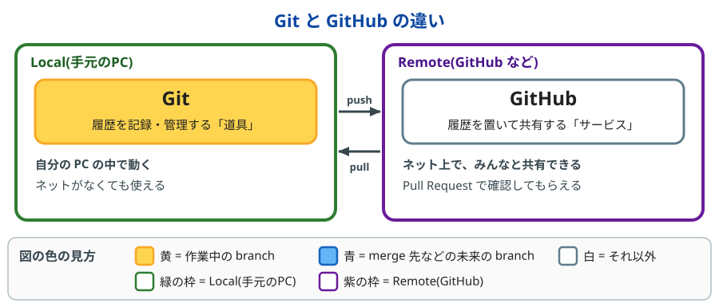
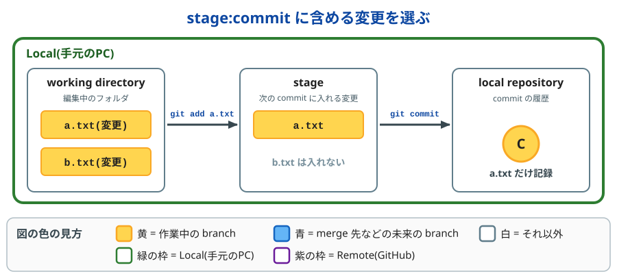
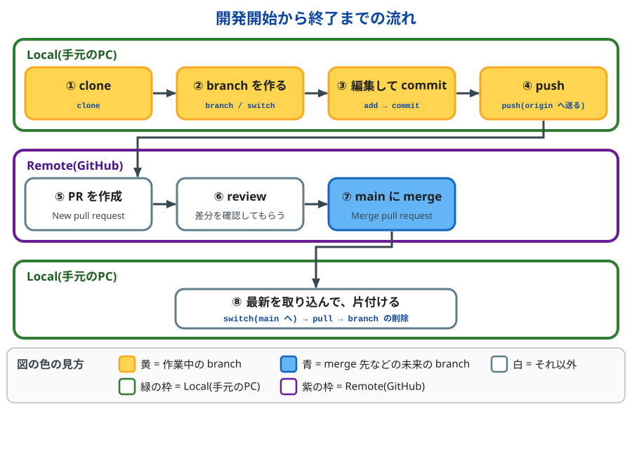

# なぜなにGit

## 目次

1. Git と GitHub の違い
2. commit と push の違い
3. stage の役割
4. branch の仕組み(具体例つき)
5. 開発開始から終了までの流れ

「なぜ必要なの?」「何が違うの?」という疑問に答える、Git の基本のページです。コマンドの一覧や用語集は、[Git入門](../git/index.html) にまとめています。

---

## 1. Git と GitHub の違い

名前は似ていますが、別のものです。



| | Git | GitHub |
|---|---|---|
| 何か | 履歴を記録・管理する**道具**(ソフトウェア) | Git の履歴を置いて共有する**サービス**(Web サイト) |
| どこにあるか | 自分の PC の中 | ネット上(remote) |
| ネットは必要か | 不要(commit や branch は PC の中だけで使える) | 必要 |
| できること | commit、branch、履歴の確認、巻き戻し | 履歴の共有、Pull Request、review、issue の管理 |

たとえると、Git は「ゲームのセーブ機能」、GitHub は「セーブデータを預けておく共有の棚」です。セーブ機能だけでも使えますが、棚に預けることで、ほかの人と同じデータを見たり、バックアップにしたりできます。

:::note info
GitHub のように、Git の履歴を置けるサービスは、ほかにもあります(GitLab、Bitbucket など)。Git の使い方は共通で、「どこに置くか」だけが違います。
:::

:::note info
Git を使うだけなら、GitHub のアカウントは要りません。共同作業をするとき、または履歴をネット上に置きたいときに、GitHub を使います。
:::

---

## 2. commit と push の違い

どちらも「記録する」ように見えますが、**記録する場所**が違います。


| | commit | push |
|---|---|---|
| 何をするか | 変更を、履歴として記録する | 手元の commit を、remote に送る |
| 記録される場所 | 手元の PC(local) | GitHub など(remote) |
| ほかの人から見えるか | 見えない | 見える |
| ネットは必要か | 不要 | 必要 |

```bash
git commit -m "ログイン画面を追加"   # 手元の履歴に記録する
git push                             # remote へ送る
```

commit だけでは、まだ自分の PC の中にしかありません。PC が壊れたり、ほかの人に見てほしいときは、push が必要です。

:::note warn
「commit したのに、GitHub に反映されていない」は、push 忘れが原因のことがほとんどです。`git status` で「Your branch is ahead of 'origin/main' by 1 commit.」と表示されたら、push していない commit が残っています。
:::

:::note info
commit は小まめに、push はひと区切りついたときに、という使い分けがよく行われます。commit は手元だけなので、気軽にやり直せます。
:::

---

## 3. stage の役割

stage は、**次の commit に入れる変更を、いったん置いておく場所**です。「荷造り」にたとえると、部屋(working directory)に散らかった物のうち、箱(stage)に入れた物だけが、発送(commit)されます。



### なぜ stage があるのか

a.txt と b.txt を両方変更したとき、「a.txt の変更だけを、1つの commit にしたい」ことがあります。stage があるおかげで、変更したファイルのうち、**commit に入れるものだけを選べます**。

1つの commit に、関係ない変更が混ざらないので、あとから「何のための commit か」が分かりやすく、巻き戻すときも楽になります。

### 具体例

```bash
git status                  # a.txt、b.txt の両方が「変更あり」と表示される
git add a.txt               # a.txt だけを stage に載せる
git status                  # a.txt は「commit される変更」、b.txt は「まだ stage されていない変更」
git commit -m "a.txt を修正"  # stage にある a.txt だけが記録される
git status                  # b.txt の変更は、まだ working directory に残っている
```

| 場所 | 役割 | そこへ移すコマンド |
|---|---|---|
| working directory | 実際にファイルを編集する場所 | (ファイルを編集する) |
| stage | 次の commit に入れる変更を置く場所 | `git add` |
| local repository | commit した履歴が残る場所 | `git commit` |

:::note info
stage から外したいときは、`git restore --staged ファイル名` を使います。ファイルの変更は消えず、stage から working directory に戻るだけです。
:::

:::note info
GitHub Desktop などの GUI ツールでは、変更ファイルの横の**チェックボックス**が stage にあたります。チェックを入れたファイルだけが commit されます。
:::

---

## 4. branch の仕組み(具体例つき)

branch は、履歴の流れを枝分かれさせて、別々に作業を進めるための仕組みです。ここでは「**ログイン画面を新しく作る**」例で、フォルダの中身がどうなるかを見ます。


### 手順

最初は、main に `index.html` だけがある状態です。

```bash
git switch -c feature/login     # 作業用の branch を作って移動する
# login.html を作る(フォルダに login.html が増える)
git add login.html
git commit -m "ログイン画面を追加"
```

この時点で、2つの branch は次のように別々の状態です。

| branch | フォルダの中身 | 状態 |
|---|---|---|
| `main` | `index.html` | ログイン画面は、まだ無い(安定した状態のまま) |
| `feature/login` | `index.html`、`login.html` | ログイン画面を作っている途中 |

### branch を切り替えると、フォルダの中身も切り替わる

```bash
git switch main            # login.html が、フォルダから消える
git switch feature/login   # login.html が、また現れる
```

`login.html` は消えたのではなく、`feature/login` の履歴に記録されているので、戻れば元通りになります。**branch ごとに、フォルダの中身が切り替わる**のが、branch の仕組みです。

### 何がうれしいのか

- ログイン画面が未完成でも、`main` は動く状態のままです
- 作業中に「別の不具合を、今すぐ直して」と頼まれたら、`main` から別の branch を作って、そちらで直せます
- 完成したら `main` に merge して、ログイン画面を取り込みます(「[Git入門](../git/index.html) の merge とは」)
- 失敗したら、その branch を捨てるだけで、`main` には影響しません

:::note info
branch は、ファイルを丸ごとコピーしているわけではありません。commit に付けた名前(しおりのようなもの)なので、作成は一瞬で、いくつ作っても重くなりません。
:::

:::note warn
branch を切り替える前に、commit していない変更があると、切り替えられなかったり、変更が一緒に付いてきたりします。切り替える前に、commit しておくのが安全です。
:::

---

## 5. 開発開始から終了までの流れ

実際の作業は、次の流れで進みます。ここでは「GitHub に repository があり、`feature` branch で作業して、main に取り込む」までを見ます。



| 手順 | やること | コマンド / 操作 | 場所 |
|---|---|---|---|
| ① clone | remote の repository を、手元にコピーする(最初の1回だけ) | `git clone URL` | Local |
| ② branch を作る | 作業用の branch を作って移動する | `git switch -c feature` | Local |
| ③ 編集して commit | ファイルを編集し、stage に載せて、記録する | `git add` → `git commit` | Local |
| ④ push | 作った branch を remote に送る | `git push -u origin feature` | Local → Remote |
| ⑤ PR を作成 | 「取り込んでください」と依頼する | GitHub で New pull request | Remote |
| ⑥ review | 差分を確認してもらう(不要なファイルや秘密情報が混ざっていないか) | GitHub 上で確認 | Remote |
| ⑦ merge | 問題なければ main に取り込む | Merge pull request | Remote |
| ⑧ 最新にして片付ける | 手元の main を最新にして、使い終わった branch を消す | `git switch main` → `git pull` → `git branch -d feature` | Local |

```bash
git clone https://github.com/ユーザー名/repository名.git   # ① 最初の1回だけ
cd repository名

git switch -c feature          # ② 作業用の branch を作る
# ファイルを編集する
git add ファイル名              # ③ stage に載せる
git commit -m "変更内容"       #    記録する(③ を繰り返す)
git push -u origin feature     # ④ remote へ送る

# GitHub で Pull Request を作成 → review → merge(⑤〜⑦)

git switch main                # ⑧ main に戻る
git pull                       #    merge された最新を取り込む
git branch -d feature          #    使い終わった branch を消す
```

次の作業は、また ② からくり返します。

:::note info
作業の途中で、ほかの人が main を更新することがあります。その場合は、push や Pull Request の前に、最新の main を自分の branch に取り込んでおくと安全です([Git入門](../git/index.html) の「逆 merge とは」)。
:::

:::note warn
同じ場所を別々に変更していると、conflict が起きます。慌てずに、解消の手順を確認してください([Git入門](../git/index.html) の「conflict とは」)。
:::

:::note info
GUI ツール(GitHub Desktop、SourceTree、TortoiseGit)でも、流れは同じです。ボタンやメニューの名前は、[Git入門](../git/index.html) の「GUIツールの用語集」を参照してください。
:::
